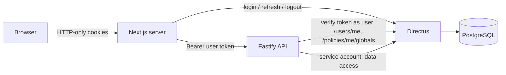

# Architecture

Component responsibilities and data-access paths are defined in spec §3 and are not repeated
here. This document records how they are implemented.

- The **browser never talks to Fastify or Directus with credentials**. It only holds two
  HTTP-only cookies set by Next.js. (Public, unauthenticated content may later be read from
  Directus by the Next.js server; see Phase 5.)
- **Fastify is internal**: in Compose it is only bound to `127.0.0.1`/the Docker network and is
  called exclusively by the Next.js server.

## Authentication and session (spec §19.1 – decided)

| Topic                         | Decision                                                                                                                                                                                                                                                                                                                                                                                 |
| ----------------------------- | ---------------------------------------------------------------------------------------------------------------------------------------------------------------------------------------------------------------------------------------------------------------------------------------------------------------------------------------------------------------------------------------- |
| Identity provider             | Directus only (local email/password). Self-registration disabled.                                                                                                                                                                                                                                                                                                                        |
| Session storage               | Next.js acts as backend-for-frontend. `bsv_access` (Directus access token, 15 min) and `bsv_refresh` (refresh token, 7 days) are `HttpOnly`, `SameSite=Lax`, `Secure` in production, `Path=/`. No token is readable by browser JS.                                                                                                                                                       |
| Login                         | Server action `loginAction` (`apps/web/src/lib/auth/actions.ts`) → Directus `/auth/login` (`mode: json`) → sets cookies. Generic error message.                                                                                                                                                                                                                                          |
| Refresh                       | `apps/web/src/proxy.ts` (Next 16 "proxy", formerly middleware) refreshes when the access token expires within 60 s, setting the new cookies on the response **and** the current request. Directus rotates refresh tokens; concurrent refreshes of the same token are deduplicated per process (30 s). Invalid refresh token → cookies cleared, `/intern/*` redirects to `/login?next=…`. |
| Logout                        | Server action → Directus `/auth/logout` (invalidates the refresh token/session) → cookies deleted.                                                                                                                                                                                                                                                                                       |
| Next.js → Fastify             | `apiFetch()` (`apps/web/src/lib/api.ts`) forwards the access token as `Authorization: Bearer`.                                                                                                                                                                                                                                                                                           |
| Token verification in Fastify | Fastify calls Directus **as the user** (`GET /users/me?fields=id` and `GET /policies/me/globals`). Directus validates signature, expiry and session; no shared JWT secret. Successful verifications are cached for 30 s (keyed by token hash).                                                                                                                                           |
| Authorization context         | After verification Fastify loads the user (status, role) and the active membership with the **service account**, uncached, so role/membership changes apply immediately. Result: `AuthContext` (= `SessionUser` in `packages/validation`).                                                                                                                                               |
| Service account               | `api-service@bsv-sws.de`, role "API-Service", static token `DIRECTUS_SERVICE_TOKEN`. Directus sees this account, so Fastify authorizes the original user itself (spec §3.4). The token is rejected if presented as a user token.                                                                                                                                                         |
| Session expiry                | Access token 15 min, refresh token 7 days (`ACCESS_TOKEN_TTL`/`REFRESH_TOKEN_TTL` in Compose; keep `REFRESH_MAX_AGE_SECONDS` in `tokens.ts` in sync). Suspended users fail on the next Fastify call (user status is checked on every request).                                                                                                                                           |

### Rate limiting (spec §11.3)

- Login: per client IP (20 / 15 min) and per email (5 / 15 min), in memory in the Next.js
  process (`RateLimiter`). Client IP comes from `X-Forwarded-For`, which must be set by our
  reverse proxy (Phase 8). Directus additionally suspends an account after 10 failed logins
  (`auth_login_attempts`).
- Directus' own IP rate limiter stays disabled: all logins arrive from the Next.js server IP.
- Fastify (`@fastify/rate-limit`, in memory, per route): invitation creation 30/h, resend 20/h,
  public token endpoints (lookup 60, register 5, resend code 3, verify 10, accept 10 per 15 min,
  keyed by client IP + token). Next.js forwards the browser IP as `x-client-ip`; Fastify trusts
  it because only the Next.js server can reach Fastify. Verification codes additionally lock
  after 5 wrong attempts.

### Email

Fastify sends application emails itself (`nodemailer`, `apps/api/src/lib/mailer.ts`, German
plain-text templates in `modules/notifications/templates.ts`) via SMTP: IONOS in deployments,
**Mailpit** locally (UI http://localhost:8025). Emails are sent only after the operation
succeeded; see [05-workflows.md](05-workflows.md#notifications-spec-102) for failure handling.
Directus uses the same SMTP settings for its own mails (e.g. password reset).

### Files

Directus files are **not** publicly readable (protected documents will live there). Club logos
are uploaded through Fastify and served via `GET /clubs/:id/logo` → Next.js route
`/api/clubs/:id/logo`.

### API conventions

- Uniform error body `{ error: { code, message, details? } }` (`apiErrorSchema`); German
  `message` for display; `VALIDATION_ERROR` carries `z.flattenError` details.
- Input is validated with Zod via `parseInput()`; authorization via
  `apps/api/src/modules/auth/authorization.ts`.
- Authorization and cookie headers are redacted from logs.

## Directus licence

Directus 12 is used under the **Open Innovation Grant (OIG)** licence. The free "Core" tier would
block custom permission rules (row filters, field restrictions) and limit Studio seats to 3. If
the licence lapses, Directus falls back to Core and ignores custom rules. Therefore **all
Directus permissions are unrestricted** and fine-grained rules live in Fastify; the setup works
identically with and without licence. Details:
[04-authorization.md](04-authorization.md).

## Reproducible Directus configuration

`directus/tools` (`pnpm directus:apply`) applies settings, the schema snapshot, policies,
permissions, roles and the service account idempotently. See [03-data-model.md](03-data-model.md)
and [09-infrastructure.md](09-infrastructure.md).
