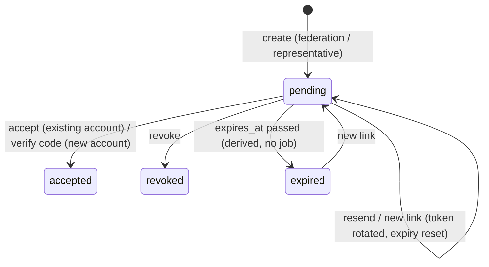
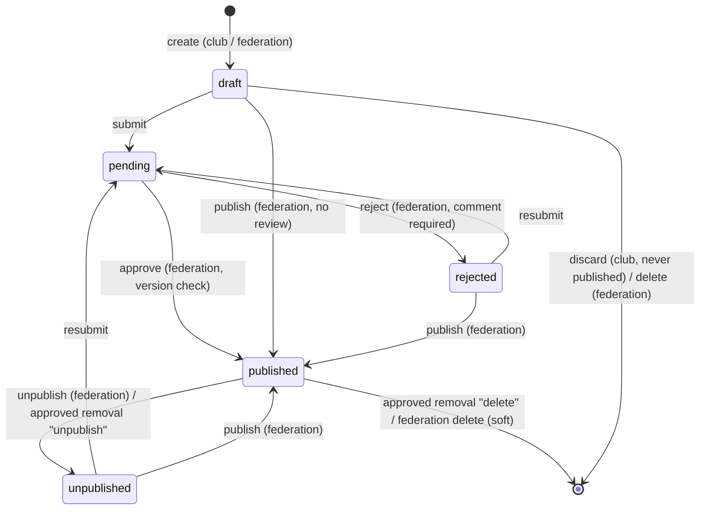

# Workflows

Requirements: spec §4–§6, §10. Event workflows follow in Phase 3. API details:
[06-api-specification.md](06-api-specification.md).

## Invitations

- **Who may invite** (`canInvite`): the federation invites representatives and members to any
  club; representatives invite **members** of their own club only (spec §5.1, §5.5).
- **Token:** 256-bit random, base64url, sent only in the link; the database stores its SHA-256
  hash. Resending/regenerating rotates the token (old link dies). The link is shown to the
  inviter once (for manual sharing) and is never retrievable again.
- **Validity:** `INVITATION_TTL_DAYS` (default 14). Only one open invitation per email + club.
- **Inviting an existing member** of the same club is rejected at creation. Membership in
  _another_ club is only revealed to the invitee at acceptance (no information leak to inviters).

### New account: registration with 6-digit code (owner decision)

1. Invitee opens `/einladung/<token>` → enters first/last name, password (≥ 10 chars), optional
   phone. Email is fixed by the invitation.
2. Fastify creates the Directus user with **status `unverified`** (cannot log in) and role
   Benutzer (or updates an existing unverified user with that email), stores an **HMAC** of a
   random 6-digit code on the invitation (`APP_SECRET`, bound to the invitation id), valid
   **15 minutes**, and emails the code to the invited address.
3. Invitee enters the code. Max. **5 wrong attempts** per code (then a new code is required);
   new codes can be requested (rate-limited) and reset the counter.
4. Correct code → user `active` → **atomic acceptance** (below) → redirect to login with notice.

Manually shared links are safe: only someone with access to the invited mailbox gets the code.

### Existing account

Logged in with the **same email** (case-insensitive) → "Einladung annehmen". Different email →
rejected (`EMAIL_MISMATCH`). Not logged in but account exists → login, then back to the link.

### Atomic acceptance

One Directus request creates the membership **with a nested update of the invitation**
(`status = accepted`, `accepted_at/by`) — Directus runs it in one transaction. Unique constraints
make races fail cleanly: `club_memberships.active_user` (second active membership →
`ALREADY_MEMBER`) and `club_memberships.invitation` (second acceptance → `INVITATION_USED`).
`created_by` on the membership is the inviter.

## Memberships

| Action           | Who                                                      | Effect                                                                                                                                            |
| ---------------- | -------------------------------------------------------- | ------------------------------------------------------------------------------------------------------------------------------------------------- |
| Promote / demote | Representatives of the club (not themselves), federation | `role` changes; membership stays active                                                                                                           |
| Remove           | Representatives of the club (not themselves), federation | `status = ended`, `active_user = NULL`, `ended_at/by`, `end_reason = removed`; **account stays active**, user may join another club by invitation |

- **No self-changes** (owner decision): representatives can never demote or remove themselves;
  another representative or the federation must do it. The federation can always override.
- **Maximum number of representatives** (spec §19.7, Phase 7): optional setting
  `max_representatives_per_club` (empty = unlimited, the default). A representative's promotion
  fails with `409 REPRESENTATIVE_LIMIT_REACHED` once the club has that many representatives. The
  federation may exceed it (spec §4.4: federation overrides representative assignments), and
  representative invitations come from the federation only, so they are not limited. Check and
  write are two requests – two simultaneous promotions could exceed the limit by one (accepted for a
  soft organisational limit).

## Clubs

- Federation creates clubs and edits all fields (`name`, `slug`, `active` are federation-only).
- Representatives edit the remaining fields of their own club and upload/remove the logo
  (PNG/JPEG/WebP, ≤ 2 MB; SVG excluded). Disallowed fields are rejected (`FIELDS_NOT_ALLOWED`).
- Logos are served publicly through `GET /clubs/:id/logo` (Fastify) and `/api/clubs/:id/logo`
  (Next.js proxy) — Directus files themselves are not public.

## Notifications (spec §10.2)

| Trigger                                            | Recipient                                                                          | Sent                                                                               |
| -------------------------------------------------- | ---------------------------------------------------------------------------------- | ---------------------------------------------------------------------------------- |
| Invitation created/resent with "per E-Mail senden" | invited address                                                                    | after the invitation is stored; failure → link still returned (`emailSent: false`) |
| Registration / new code                            | invited address (6-digit code)                                                     | failure → `502 EMAIL_FAILED`, user retries                                         |
| Member accepted                                    | active representatives of the club (except the new user)                           | after acceptance; failure only logged                                              |
| Representative accepted                            | `notification_settings.representative_joined_recipients` (Verband → Einstellungen) | after acceptance; failure only logged                                              |

Emails are plain text, German, sent via SMTP (IONOS in deployments, Mailpit locally).

## Audit actions

Written by Fastify after the operation succeeded, actor = original user
(`apps/api/src/modules/audit`). A failed audit write is retried once, then logged at error level
with the full entry.

| Action                                                                                  | Entity                |
| --------------------------------------------------------------------------------------- | --------------------- |
| `club.created`, `club.updated` (changed fields before/after), `club.logo_changed`       | clubs                 |
| `invitation.created`, `invitation.resent`, `invitation.revoked`, `invitation.accepted`  | invitations           |
| `user.verified`                                                                         | directus_users        |
| `membership.created`, `membership.promoted`, `membership.demoted`, `membership.removed` | club_memberships      |
| `settings.updated` (only changed settings, before/after)                                | notification_settings |

German labels for the log view: `AUDIT_ACTION_LABELS` in `packages/shared/src/audit.ts` – add new
actions there too.

## Events (Phase 3)

Rules (implemented in `apps/api/src/modules/events/event-rules.ts`, unit-tested):

| Topic                    | Rule                                                                                                                                                                                                                                                                                                                            |
| ------------------------ | ------------------------------------------------------------------------------------------------------------------------------------------------------------------------------------------------------------------------------------------------------------------------------------------------------------------------------- |
| Create                   | Representatives for their own club (organizer: own club or external organisation); federation for any club or the federation itself (`clubId = null`, official by default). Members cannot create events.                                                                                                                       |
| Edit                     | Owning club's representatives and the federation, in **every status incl. pending** (owner decision). Federation may change everything.                                                                                                                                                                                         |
| Locked after publication | For representatives: `title`, `startDate`, `endDate` (spec §7.9). Times and all other fields stay editable; edits are visible immediately. Federation may override.                                                                                                                                                             |
| Federation-only fields   | `official`, `clubId` (owning club), organizer "BSV-SWS".                                                                                                                                                                                                                                                                        |
| Review                   | Approve/reject require the `version` (`updatedAt`) the reviewer saw → `409 EVENT_CHANGED` if the club edited meanwhile (safeguard for editable pending events). Rejection needs a comment; the last comment stays on the event (`review_comment`) and in the history.                                                           |
| Direct publish           | Federation publishes its own events and events created on behalf of clubs without review (spec §7.8).                                                                                                                                                                                                                           |
| Removal                  | Representatives request **unpublish** or **delete** for published events (owner decision) with a reason. The event stays **published and editable** until the federation decides (spec §7.10). One open request per event (unique `pending_event`). Approval and the event change are one nested write. "Delete" = soft delete. |
| Discard                  | Representatives soft-delete their own never-published drafts and rejected events (owner decision).                                                                                                                                                                                                                              |
| Delete                   | Federation soft-deletes any event; deleted events are hidden everywhere except the federation archive (`/intern/veranstaltungen?archiv=1`). Nothing is physically deleted.                                                                                                                                                      |
| Visibility               | spec §7.11: published → everyone; draft/pending/rejected/unpublished → owning club's representatives + federation. Others get `404`.                                                                                                                                                                                            |
| Files                    | Attachments (file type + optional description, PDF/Office/text/ZIP/images ≤ 20 MB) and title image/logo (PNG/JPEG/WebP ≤ 5 MB). Downloads are public for published events, otherwise only for users who may view the event.                                                                                                     |
| Schedule                 | SwimResults model: sections (Abschnitte), races (Wettkämpfe) and programme items (Einlass, Einschwimmen, Kampfrichter-/Mannschaftsleitersitzung, Pause, Siegerehrung, …) in one ordered list. Replaced as a whole on save (nested write).                                                                                       |
| Categories               | Administrator-managed in Studio (federation can add/rename/deactivate); only active categories can be assigned. Initial: Wettkampf, Kampfrichter, Verband.                                                                                                                                                                      |

### SwimResults (owner decision)

With a SwimResults id the public event page loads data **live** from the public SwimResults API
(`apps/api/src/modules/swimresults`, cached in memory for `SWIMRESULTS_CACHE_SECONDS`, default
5 min; failures cached 1 min, 4 s timeout):

| Endpoint (`SWIMRESULTS_API_URL`)    | Used for                                                  |
| ----------------------------------- | --------------------------------------------------------- |
| `meeting/v1/file/meeting/list/<id>` | Files (type, download from `SWIMRESULTS_DOWNLOAD_URL`)    |
| `meeting/v1/event/meet/<id>/parts`  | Sections with races                                       |
| `meeting/v1/incident/meet/<id>`     | Items before (`next_event`) / after (`prev_event`) a race |

- **Per section:** SwimResults replaces the schedule only if it has races, the file list only if
  it has files; otherwise – or if SwimResults is unreachable – the manually entered data is shown.
  Manual data is never overwritten in Directus.
- Files that SwimResults announces but has not published yet are listed as "noch nicht
  verfügbar"; only http(s) links are rendered. Times are UTC and shown in Europe/Berlin.
- Links Livetiming / Echtzeit-Ergebnisse / Sportler finden (`SWIMRESULTS_APP_URL/m/<id>/…`) are
  shown whenever the id is set. Mapping rules are unit-tested with real IESC26 responses.

### Event notifications

| Trigger                            | Recipient                                                                                                       |
| ---------------------------------- | --------------------------------------------------------------------------------------------------------------- |
| Submitted / resubmitted            | `notification_settings.event_review_recipients` (Verband → Einstellungen; no review rights implied, spec §10.3) |
| Approved / rejected (with comment) | Submitter (`submitted_by`)                                                                                      |
| Removal requested                  | Event review recipients (owner decision)                                                                        |
| Removal decided                    | Requester (owner decision)                                                                                      |

### Event history (spec §19.4)

The audit log is the single source: every action below is recorded with actor, comment and
(for edits) the changed fields before/after. `GET /events/:id/history` shows it to the owning
club and the federation.

`event.created`, `event.updated`, `event.submitted`, `event.resubmitted`, `event.approved`,
`event.rejected`, `event.published`, `event.unpublished`, `event.removal_requested`,
`event.removal_approved`, `event.removal_rejected`, `event.deleted`, `event.discarded`,
`event.file_added`, `event.file_removed`, `event.image_changed`.

## CMS: news, pages, navigation (Phase 5)

Editing happens in **Directus Studio** (spec §3.3) by federation users and administrators; the
website reads through Fastify. Editor guide (German): [redaktion.md](redaktion.md).

| Topic      | Rule                                                                                                                                                                                                                                                                                                                                                    |
| ---------- | ------------------------------------------------------------------------------------------------------------------------------------------------------------------------------------------------------------------------------------------------------------------------------------------------------------------------------------------------------- |
| Articles   | Visible when `status = published` **and** `published_at ≤ now` (future date = scheduled). Exactly one category. Author shown as `author_name` → `author` → creator. No approval workflow, no emails (spec §8.2). URL `/news/<slug>` (same as the old site).                                                                                             |
| Pages      | URL = path of slugs (`/verband/vorstand`, same as the old site). Reachable only if the page **and all ancestors** are published. Visibility: 4 fixed levels, see [Protected content](#protected-content-phase-6). Duplicate paths: first by sort wins. Reserved top-level slugs are shadowed by app routes.                                             |
| Navigation | Three menus (main, footer, internal), nested up to 4 levels, ordered by `sort`. Items link to a page, article, internal route or external URL, or are group labels. Items are hidden if inactive, not visible for the user level, their target is unpublished/invisible, or a group has no visible children. Unsafe URLs (`javascript:` …) are dropped. |
| Home       | Intro from page `startseite`, latest 3 articles, next 5 events (owner decision).                                                                                                                                                                                                                                                                        |
| Club pages | `/vereine`, `/vereine/<slug>` generated from active club records (+ upcoming events of the club). No manual duplicate content (spec §8.6).                                                                                                                                                                                                              |
| Redirects  | `redirects` collection, consulted only when no page matches a path: exact `path?query` first, then `path`; 308 (permanent) or 307.                                                                                                                                                                                                                      |
| Media      | News uploads land in **Öffentliche Medien** (always public), page uploads in **Seitendokumente** (visible like the referencing pages, Phase 6). Served via `/medien/<id>` (optional `?width=`); Directus asset URLs in content are rewritten to this proxy.                                                                                             |
| Sanitizing | Article/page HTML is sanitized in Fastify (allowlist; no scripts, event handlers, styles, iframes, unsafe schemes; `h1` → `h2`; external links get `rel="noopener noreferrer"`).                                                                                                                                                                        |
| Base data  | `directus:apply` creates (only if empty) the page tree of the old site with placeholder text, main + footer navigation, the default news category and the media folder (owner decision: all environments).                                                                                                                                              |

## Protected content (Phase 6)

| Topic         | Rule                                                                                                                                                                                                                                                                            |
| ------------- | ------------------------------------------------------------------------------------------------------------------------------------------------------------------------------------------------------------------------------------------------------------------------------- |
| Levels        | `public` < `club` (members and representatives) < `club_representative` < `federation` (spec §8.4). A page's effective level is the strictest along its path.                                                                                                                   |
| URLs          | Public pages: `/<path>`. Protected pages (owner decision): `/intern/seiten/<path>` inside the internal layout. The old public URL of a protected page redirects (307) there, which leads through the login. An internal URL of a public page redirects (308) to the public URL. |
| No access     | Logged in with insufficient level → **403** "Dafür fehlt dir die Berechtigung." (owner decision; no title or content revealed). Not logged in → login with `next`.                                                                                                              |
| Files         | A file in "Seitendokumente" is visible to whoever may see at least one published page/article referencing it; unreferenced or draft-only files are 404 for everyone. Copying the URL does not bypass this (checked on every request).                                           |
| Internal menu | Directus menu "Interner Bereich" (`internal`), shown in the internal navigation below the fixed app links, filtered per level.                                                                                                                                                  |
| Dashboard     | `/intern` shows actionable indicators per role (spec §10.4): federation – submitted events, removal requests, clubs without representative, active clubs; representatives – rejected/draft/pending events, open invitations, members; all club users – upcoming club events.    |

## Federation administration (Phase 7)

| Area                  | Where                              | Notes                                                                                                                               |
| --------------------- | ---------------------------------- | ----------------------------------------------------------------------------------------------------------------------------------- |
| Dashboard             | `/intern`                          | Review counts, clubs without representative, active clubs, links to content administration in Directus Studio                       |
| Clubs and memberships | `/intern/verband/vereine`, `/<id>` | Create/edit clubs, invite (also representatives), promote/demote/remove – unchanged from Phase 2                                    |
| Event review          | `/intern/verband/pruefung`         | Unchanged from Phase 3                                                                                                              |
| Accounts              | `/intern/verband/benutzer`         | Read-only overview (owner decision): search name/email, filter (without club, representatives, federation), level, club, last login |
| Audit log             | `/intern/verband/protokoll`        | Newest first, 50 per page, filter by area (action prefix) and club, before/after details                                            |
| Settings              | `/intern/verband/einstellungen`    | Notification recipients and representative limit (owner decision: in the app, Studio read-only); validated, deduplicated, audited   |
| Content               | Directus Studio                    | News, pages, navigation, redirects, event categories (spec §3.3); club users never get Studio access                                |
