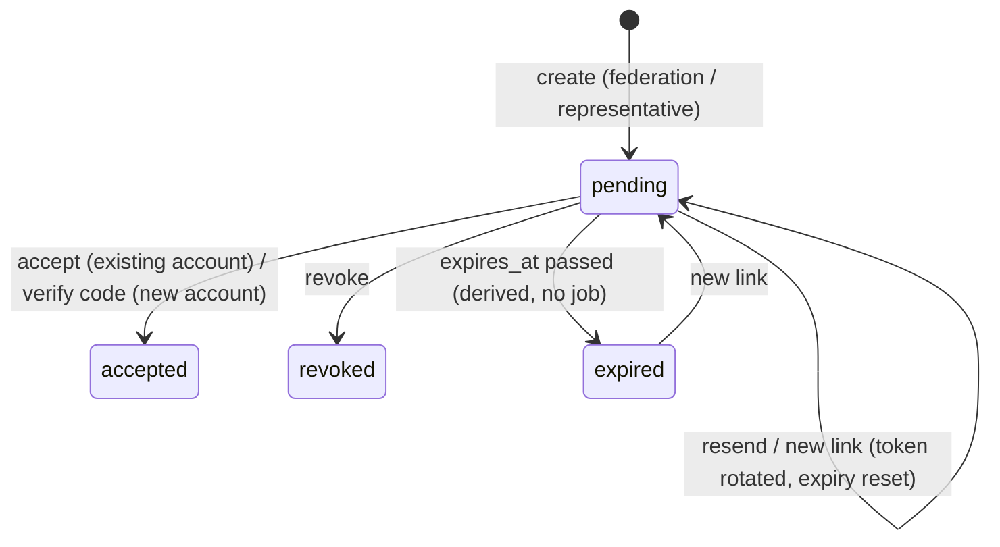

# Workflows

Requirements: spec §4–§6, §10. Event workflows follow in Phase 3. API details:
[06-api-specification.md](06-api-specification.md).

## Invitations

- **Who may invite** (`canInvite`): the federation invites representatives and members to any
  club; representatives invite **members** of their own club only (spec §5.1, §5.5).
- **Token:** 256-bit random, base64url, sent only in the link; the database stores its SHA-256
  hash. Resending/regenerating rotates the token (old link dies). The link is shown to the
  inviter once (for manual sharing) and is never retrievable again.
- **Validity:** `INVITATION_TTL_DAYS` (default 14). Only one open invitation per email + club.
- **Inviting an existing member** of the same club is rejected at creation. Membership in
  _another_ club is only revealed to the invitee at acceptance (no information leak to inviters).

### New account: registration with 6-digit code (owner decision)

1. Invitee opens `/einladung/<token>` → enters first/last name, password (≥ 10 chars), optional
   phone. Email is fixed by the invitation.
2. Fastify creates the Directus user with **status `unverified`** (cannot log in) and role
   Benutzer (or updates an existing unverified user with that email), stores an **HMAC** of a
   random 6-digit code on the invitation (`APP_SECRET`, bound to the invitation id), valid
   **15 minutes**, and emails the code to the invited address.
3. Invitee enters the code. Max. **5 wrong attempts** per code (then a new code is required);
   new codes can be requested (rate-limited) and reset the counter.
4. Correct code → user `active` → **atomic acceptance** (below) → redirect to login with notice.

Manually shared links are safe: only someone with access to the invited mailbox gets the code.

### Existing account

Logged in with the **same email** (case-insensitive) → "Einladung annehmen". Different email →
rejected (`EMAIL_MISMATCH`). Not logged in but account exists → login, then back to the link.

### Atomic acceptance

One Directus request creates the membership **with a nested update of the invitation**
(`status = accepted`, `accepted_at/by`) — Directus runs it in one transaction. Unique constraints
make races fail cleanly: `club_memberships.active_user` (second active membership →
`ALREADY_MEMBER`) and `club_memberships.invitation` (second acceptance → `INVITATION_USED`).
`created_by` on the membership is the inviter.

## Memberships

| Action           | Who                                                      | Effect                                                                                                                                            |
| ---------------- | -------------------------------------------------------- | ------------------------------------------------------------------------------------------------------------------------------------------------- |
| Promote / demote | Representatives of the club (not themselves), federation | `role` changes; membership stays active                                                                                                           |
| Remove           | Representatives of the club (not themselves), federation | `status = ended`, `active_user = NULL`, `ended_at/by`, `end_reason = removed`; **account stays active**, user may join another club by invitation |

- **No self-changes** (owner decision): representatives can never demote or remove themselves;
  another representative or the federation must do it. The federation can always override.
- No maximum number of representatives yet (spec §19.7: configurable later).

## Clubs

- Federation creates clubs and edits all fields (`name`, `slug`, `active` are federation-only).
- Representatives edit the remaining fields of their own club and upload/remove the logo
  (PNG/JPEG/WebP, ≤ 2 MB; SVG excluded). Disallowed fields are rejected (`FIELDS_NOT_ALLOWED`).
- Logos are served publicly through `GET /clubs/:id/logo` (Fastify) and `/api/clubs/:id/logo`
  (Next.js proxy) — Directus files themselves are not public.

## Notifications (spec §10.2)

| Trigger                                            | Recipient                                                                                       | Sent                                                                               |
| -------------------------------------------------- | ----------------------------------------------------------------------------------------------- | ---------------------------------------------------------------------------------- |
| Invitation created/resent with "per E-Mail senden" | invited address                                                                                 | after the invitation is stored; failure → link still returned (`emailSent: false`) |
| Registration / new code                            | invited address (6-digit code)                                                                  | failure → `502 EMAIL_FAILED`, user retries                                         |
| Member accepted                                    | active representatives of the club (except the new user)                                        | after acceptance; failure only logged                                              |
| Representative accepted                            | `notification_settings.representative_joined_recipients` (Directus Studio → Benachrichtigungen) | after acceptance; failure only logged                                              |

Emails are plain text, German, sent via SMTP (IONOS in deployments, Mailpit locally).

## Audit actions

Written by Fastify after the operation succeeded, actor = original user
(`apps/api/src/modules/audit`). A failed audit write is retried once, then logged at error level
with the full entry.

| Action                                                                                  | Entity           |
| --------------------------------------------------------------------------------------- | ---------------- |
| `club.created`, `club.updated` (changed fields before/after), `club.logo_changed`       | clubs            |
| `invitation.created`, `invitation.resent`, `invitation.revoked`, `invitation.accepted`  | invitations      |
| `user.verified`                                                                         | directus_users   |
| `membership.created`, `membership.promoted`, `membership.demoted`, `membership.removed` | club_memberships |
