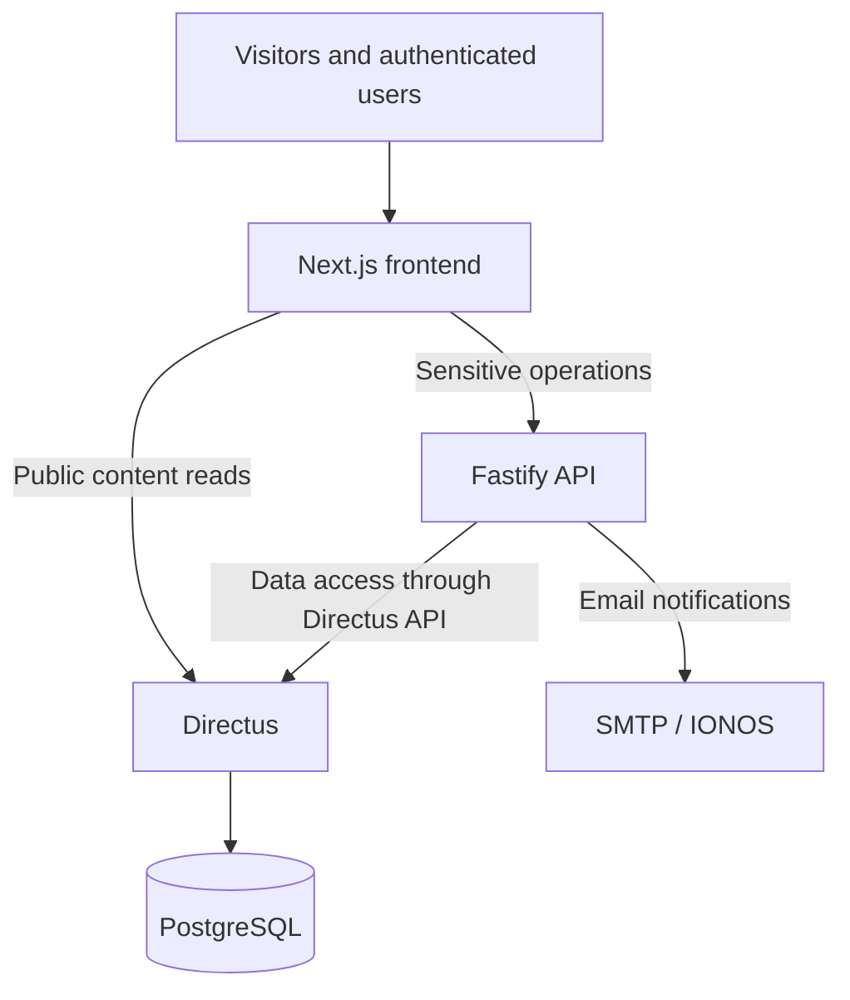
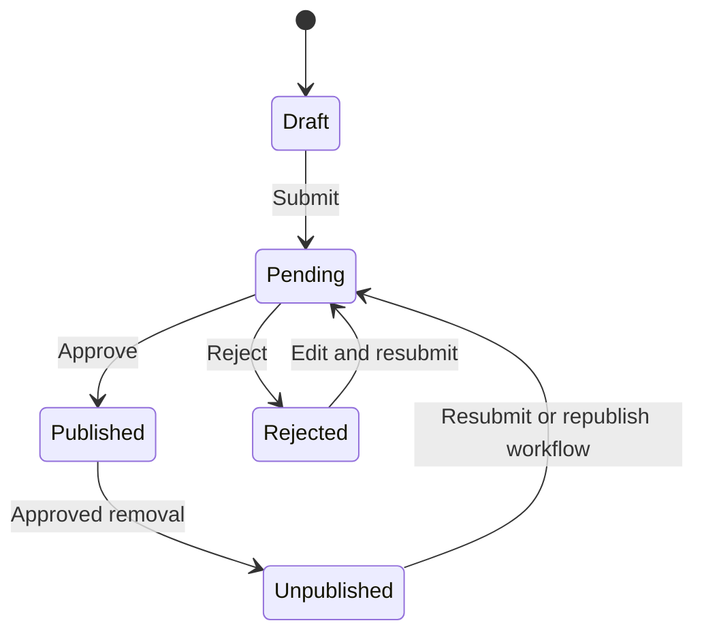

# BSV-SWS Website — Project Specification & AI Agent Blueprint

**Project:** Complete replacement of the Bezirksschwimmverband Südwestsachsen website  
**Current website:** https://bsv-sws.de/  
**Document purpose:** Central functional and technical specification for AI coding agents  
**Status:** Requirements gathering completed  
**Primary language of the website:** German  
**Documentation language:** English for technical documentation; German for content documentation and user-facing labels

---

# 1. Project Overview

## 1.1 Objective

The project is a complete replacement of the existing Joomla website of the **Bezirksschwimmverband Südwestsachsen (BSV-SWS)**.

The BSV-SWS is a regional swimming association that oversees and coordinates numerous swimming clubs in its district. The website serves several purposes:

- Public information about the association and its activities.
- Publication of news and general information.
- Publication and management of swimming-related events.
- Presentation of the clubs belonging to the association.
- Internal information and functionality for club members and representatives.
- Administrative functionality for the association's federation users.
- Centralized user and membership management.
- Event submission, review and publication workflows.

The new application should replace the existing Joomla installation rather than coexist with it as a separate system.

The current website should be used as the reference for existing content, navigation and visual design:

https://bsv-sws.de/

The existing design should generally be preserved, with the possibility of modest modernization. The project owner will handle most of the visual design decisions. AI agents should concentrate on implementing the functionality and the supplied design direction rather than inventing a completely new visual identity.

## 1.2 General principles

1. Build one central website. Do not split the application into separate websites or subdomains for different user groups.
2. The public website and authenticated internal area belong to the same application.
3. All website content and user-facing labels are German.
4. Technical documentation, code comments where useful, architecture documentation and agent instructions are English.
5. Database collection names, code identifiers, API identifiers and internal role identifiers are English.
6. The application must be fully responsive.
7. The application must support the complete club and federation workflows described in this document.
8. The system should be maintainable by a small team and should avoid unnecessary complexity.
9. AI agents may make normal implementation decisions within the defined architecture.
10. Significant architectural, data-model or authorization changes require approval from the project owner.
11. Documentation must be updated whenever implementation changes affect documented behavior or architecture.
12. Do not create wireframes or mockups as a prerequisite for implementation. The project owner will provide visual direction as needed.

## 1.3 Scope

The project includes:

- Public website and navigation.
- User authentication and invitation-only registration.
- Club and membership management.
- Club representatives and their permissions.
- Federation user management.
- News and general content management.
- Club pages generated from club records.
- Event creation and management.
- Event approval workflows.
- Event calendar and public WebCal feeds.
- Internal pages and protected documents.
- Email notifications.
- Administrative functionality.
- Deployment, backups and CI/CD.

The following are explicitly not part of the initial implementation:

- Full SwimResults integration. Only a SwimResults ID field is required initially.
- Event registration or participant registration.
- Recurring events.
- Automatic imports of events from higher-level associations.
- A notification center.
- Multiple independent websites.
- A complex document-management system.
- A complete redesign of the existing visual identity.

---

# 2. Technology Stack

The following technology choices are confirmed.

| Area | Technology |
|---|---|
| Frontend | Next.js |
| Frontend framework | React |
| Routing | Next.js App Router |
| Styling | Tailwind CSS and SCSS |
| UI components | shadcn/ui |
| Backend API | Fastify |
| Backend language | TypeScript |
| CMS and data management | Directus |
| Database | PostgreSQL |
| Validation | Zod |
| Testing | Vitest |
| Directus integration | Directus SDK |
| Package manager | pnpm |
| Monorepo build system | Turborepo |
| Containerization | Docker |
| Local orchestration | Docker Compose |
| Source control | GitHub |
| CI/CD | GitHub Actions |
| Email | SMTP through existing IONOS infrastructure |

## 2.1 Monorepo

Use a GitHub monorepo with pnpm workspaces and Turborepo.

A suggested initial structure:

```text
bsv-sws/
├── apps/
│   ├── web/                    # Next.js frontend
│   └── api/                    # Fastify backend
│
├── packages/
│   ├── shared/                 # Shared types and utilities
│   ├── validation/             # Shared Zod schemas
│   ├── directus/               # Directus SDK/client utilities
│   └── ui/                     # Shared UI components
│
├── directus/
│   └── extensions/             # Custom Directus extensions
│
├── infrastructure/
│   ├── docker/
│   ├── compose/
│   ├── scripts/
│   └── deployment/
│
├── docs/
│   ├── architecture/
│   ├── requirements/
│   ├── api/
│   ├── data-model/
│   └── operations/
│
├── AGENTS.md
├── package.json
├── pnpm-workspace.yaml
├── turbo.json
└── README.md
```

This is a recommended starting structure, not a requirement to create every directory immediately. Adjust it where a clear technical reason exists.

### Monorepo requirements

- Shared TypeScript types should be placed in appropriate shared packages.
- Shared validation schemas should be defined once where practical.
- Avoid circular dependencies between packages.
- Keep frontend-specific and backend-specific code separate.
- Do not put business logic in the shared package merely to avoid duplication.
- The shared UI package should contain reusable components, not entire application layouts.
- Public and internal layouts must remain separate even if they use shared components.

---

# 3. System Architecture

## 3.1 Responsibility of each component

The architecture separates the presentation layer, business logic and CMS/data layer.

### Next.js

Next.js is responsible for:

- Public website rendering.
- Public navigation and page layouts.
- News and article presentation.
- Public club pages.
- Public event pages and calendar views.
- Authenticated frontend views.
- Club representative dashboards.
- Federation dashboards.
- Forms and user interactions.
- Frontend validation and error presentation.
- Session handling and secure communication with backend services.

Public content should use SSR or SSG where appropriate.

Authenticated dashboards and other user-specific views should use dynamic rendering or client-side data fetching as appropriate.

### Fastify

Fastify is responsible for:

- Application-specific business logic.
- Sensitive operations.
- Membership workflows.
- Invitation creation and acceptance.
- Promotion and demotion of club members.
- Club membership removal.
- Event creation and submission.
- Event review and approval.
- Event rejection and resubmission.
- Event unpublishing and deletion workflows.
- Application-level authorization.
- Audit logging.
- Email notifications.
- WebCal generation if implemented as an API responsibility.
- Validation of requests and state transitions.

Fastify is the authoritative application entry point for sensitive operations.

### Directus

Directus is responsible for:

- PostgreSQL data persistence.
- CMS functionality.
- Content management.
- Directus Studio.
- Authentication and identity management.
- Basic role and policy management.
- Data schema management.
- File storage and file metadata.
- Access to application data through the Directus API.

Directus should provide the data-management interface for federation administrators and, where appropriate, limited federation users.

Representatives and ordinary club members must use the Next.js frontend. They must not receive Directus Studio access.

### PostgreSQL

PostgreSQL is the application's database.

**Directus is the only component that accesses PostgreSQL directly.**

Fastify must not use direct PostgreSQL connections or issue SQL queries against the application database. All application data access from Fastify must go through Directus APIs or the Directus SDK.

This is an intentional architectural constraint.

## 3.2 Architecture diagram



Do not introduce a second direct database-access path.

## 3.3 Data access rules

| Operation | Recommended path |
|---|---|
| Read public articles | Next.js → Directus |
| Read public events | Next.js → Directus |
| Read public club information | Next.js → Directus |
| Read public pages | Next.js → Directus |
| Read protected documents | Authenticated access through a permission-enforcing backend path |
| Edit own profile | Directus or Fastify, depending on the final session and authorization design |
| Create or accept invitations | Next.js → Fastify → Directus |
| Manage club membership | Next.js → Fastify → Directus |
| Create or submit events | Next.js → Fastify → Directus |
| Approve or reject events | Next.js → Fastify → Directus |
| Create official federation events | Next.js → Fastify → Directus |
| Manage CMS articles | Directus Studio |
| Manage navigation | Directus Studio |
| Manage core system configuration | Directus Studio / administrative tooling |

Important: a read operation is not automatically safe merely because it uses Directus. Protected information and files must enforce the correct access policy.

## 3.4 Authentication and authorization

Directus is the exclusive authentication provider.

Do not introduce Auth.js, Clerk, Firebase Authentication or another independent identity provider.

The frontend must use secure session handling. The preferred direction is:

- Secure HTTP-only cookies.
- No refresh tokens exposed to browser JavaScript.
- Access tokens handled server-side where possible.
- Fastify validates the identity represented by the Directus access token.
- The original user identity must remain available to Fastify for business authorization.

The exact implementation of token verification, refresh handling and the Next.js-to-Fastify communication path must be documented before implementing the full authentication flow.

Do not assume that an arbitrary token format or verification endpoint is available without checking the configured Directus version and authentication configuration.

### Important service-account rule

Fastify may need a dedicated restricted Directus service account for privileged data operations.

However, Directus sees that service account as the caller, not the original frontend user.

Therefore:

- Fastify must validate the original user's identity.
- Fastify must enforce the original user's application permissions.
- Fastify must not rely on the service account's Directus permissions as proof that the original user is authorized.
- The service account must have the least privileges required.
- Privileged Directus credentials must never be exposed to the frontend.

Where practical, user-scoped Directus operations should forward the authenticated user's token so that Directus can also enforce user-level policies.

## 3.5 Business authorization

Business authorization must be enforced in Fastify for sensitive workflows.

Directus roles and policies can provide an additional security layer, but they must not be treated as a replacement for application-level authorization.

For example:

- A club representative may manage their own club but not another club.
- A representative may promote members of their own club.
- A federation user may manage any club.
- An ordinary member must not be able to submit an event on behalf of another club.
- A user must not be able to modify an approved event's locked dates.
- A user must not be able to approve their own event merely by manipulating a request.

Authorization must be checked on the server for every sensitive request. Hiding a button in the frontend is not sufficient.

---

# 4. Users, Roles and Memberships

## 4.1 User groups

There are five user levels.

Internal role identifiers should be English. The following names are suggested:

| German label | Suggested internal identifier | Description |
|---|---|---|
| Besucher | `visitor` | Unauthenticated visitor |
| Verein | `club_member` | Ordinary member associated with a club |
| Vereinsvertreter | `club_representative` | Club member with administrative rights for their club |
| Verband | `federation` | Federation user |
| Administrator | `administrator` | System administrator |

The visitor level does not necessarily need a persisted user role. It can represent unauthenticated access.

## 4.2 Club membership

Ordinary members and representatives belong to a club.

A normal user may have at most one active club membership.

Federation users do not require a club membership, but may optionally be associated with a club.

Club membership and global federation privileges must be modeled separately.

**Recommended data-model approach:** use a dedicated membership relation rather than storing only a `club_id` directly on the user.

This allows the system to retain membership history after a user leaves or is removed from a club.

A membership should contain at least:

- User.
- Club.
- Membership role.
- Creation date.
- Status.
- Optional end date.
- Relevant audit information.

Possible membership roles:

- `member`
- `representative`

The membership role is distinct from global federation or administrator privileges.

## 4.3 Role hierarchy and permissions

### Ordinary club member (`club_member`)

An ordinary club member:

- Belongs to one club.
- Can access content visible to club members.
- Can access relevant internal club information.
- Has no default write permissions.
- Cannot manage other members.
- Cannot manage club information.
- Cannot create or approve events.

### Club representative (`club_representative`)

A representative can manage their own club.

Permissions include:

- Edit club information.
- Upload or change the club logo.
- Invite new club members.
- Promote ordinary members to representatives.
- Demote representatives to ordinary members.
- Remove members from the club.
- Publish news associated with the club.
- Create and manage events associated with the club.
- Submit events for federation approval.
- View their club's drafts and submitted events.

Representatives must never be able to manage another club unless they also have federation-level privileges.

A club may initially have zero representatives. Its public club page must still exist, but no club user can manage the club until a representative is assigned.

### Federation (`federation`)

Federation users can:

- Manage all clubs.
- Manage all memberships.
- Invite users to any club.
- Invite new representatives.
- Promote or demote members and representatives.
- Remove users from clubs.
- Perform all actions available to representatives across all clubs.
- Create official events directly.
- Create events on behalf of clubs.
- Review submitted events.
- Approve and publish events.
- Reject submitted events.
- Approve event unpublishing or deletion.
- Manage website content.
- Manage news articles.
- Manage navigation.
- Access federation-level internal content.
- Manage event calendars and categories where authorized.

Federation users do not necessarily need a club membership.

### Administrator (`administrator`)

Administrators have full system-level privileges.

They can:

- Manage users and roles.
- Manage Directus.
- Manage application configuration.
- Manage all clubs and memberships.
- Manage all content and events.
- Manage system-level permissions.
- Access all administrative functions.

## 4.4 Promotion and demotion

Representatives may promote ordinary members of their own club to representative status without federation approval.

A maximum number of representatives per club should be configurable in the future. Do not hard-code a permanent maximum into the data model.

Federation users can override representative assignments.

When a representative is demoted:

- The user loses representative privileges.
- The user remains an ordinary member of the same club.
- The active club membership remains.

When a user is removed from a club:

- The user loses the club membership entirely.
- Club-specific permissions are removed.
- The account remains active.
- The user can no longer access club-restricted information.
- The user may accept an invitation to another club.

Do not delete the user's account when their club membership is revoked.

## 4.5 Audit logging

Important actions must be logged.

Use an explicit application audit log rather than relying exclusively on Directus activity logs.

The audit log should capture:

- Actor.
- Action.
- Affected entity.
- Entity identifier.
- Timestamp.
- Relevant before/after values where appropriate.
- Reason or comment where applicable.
- Relevant context such as club or event.

Examples:

- Invitation created.
- Invitation accepted.
- Member promoted.
- Representative demoted.
- Member removed.
- Club information changed.
- Event submitted.
- Event rejected.
- Event approved.
- Event unpublished.
- Event deleted.

Audit records should not be editable by ordinary users.

---

# 5. Invitations and Registration

## 5.1 Invitation-only registration

There must be no unrestricted public registration.

Every new account must originate from a valid invitation.

There are two principal invitation flows:

1. Initial representative invitation from the federation.
2. Ordinary member invitation from a club representative or federation user.

The federation is the only party allowed to create the initial representative invitation.

## 5.2 Invitation properties

An invitation should contain:

- Unique identifier.
- Secure token.
- Hashed token storage where appropriate.
- Target email address.
- Target club.
- Intended membership role.
- Issuing user.
- Creation timestamp.
- Expiration timestamp.
- Acceptance timestamp.
- Status.

Invitation tokens should be cryptographically secure, single-use and expire after a configurable period.

The system must not store reusable invitation secrets in plaintext.

## 5.3 Invitation behavior

One invitation link permits exactly one user to register or log in and join the specified club.

The link may be:

- Sent by email.
- Generated by the system and shared manually.

When the recipient opens the link:

1. Validate the invitation.
2. Check expiration and whether it has already been used.
3. If the user is not authenticated, allow registration or login.
4. If the user is authenticated, verify that the account email matches the invitation's target email.
5. Verify that the user does not already have another active club membership.
6. Create the club membership with the intended role.
7. Mark the invitation as accepted.
8. Record the action in the audit log.

Invitation acceptance should be atomic. The invitation must not be accepted twice, and partial membership creation must not leave inconsistent data.

A user who already has an active membership in another club must not be able to accept a second club invitation.

## 5.4 Initial representative invitation

The initial representative account is created through a federation-issued invitation.

The invitation must:

- Identify the target club.
- Identify the intended representative role.
- Be sent to the intended email address.
- Grant representative privileges after successful acceptance.

A club may initially have no representatives until this invitation is accepted.

## 5.5 Ordinary member invitation

A club representative may invite ordinary members of their own club.

Federation users may invite ordinary members to any club.

The club is assigned through the invitation. Users cannot independently choose or change their club.

## 5.6 Email verification

Email verification is required.

The system must ensure that an invitation cannot be used to register an unrelated email address.

Email verification and invitation acceptance must work together without allowing an unverified account to obtain membership privileges.

## 5.7 Invitation notifications

Required emails:

- Invitation to create a member account.
- Invitation to create a representative account.
- Notification when an invitation is accepted.

Notification recipients:

- When an ordinary member joins, the representative(s) of that member's club are notified.
- The federation does not receive a notification for every ordinary member joining.
- When a representative joins, the federation is notified.
- The system should support email invitations and manual link sharing.

---

# 6. Clubs

## 6.1 Club records

The federation maintains a known list of all clubs in the district.

Clubs are created and managed by the federation.

Club records should contain the information required to generate the public club pages.

The exact field list should be derived from the existing website and agreed content requirements.

At minimum, support:

- Club name.
- Club logo.
- Public contact and information fields as required.
- Club-specific website or external links where applicable.
- Relevant descriptive information.

## 6.2 Club pages

Public club pages are generated automatically from club records.

Do not create duplicate manually maintained content for the same club information.

Changing a club record should update the corresponding public club page.

Club representatives may edit the fields they are authorized to manage.

The federation can manage all club records.

## 6.3 Club management authorization

A representative may manage only their own club.

A federation user may manage any club.

A club with no representative remains publicly visible but cannot be managed by club users.

---

# 7. Events

Events are one of the central features of the website.

The system must support swimming-related competitions, association events, official events and events organized by clubs or external organizations.

## 7.1 Event ownership and organizer

Events are not necessarily associated with a club.

Possible organizers include:

- A club.
- BSV-SWS.
- An arbitrary external organization.

The data model must support these different organizer types without requiring every event to have a club relationship.

Federation users may create events on behalf of clubs.

Federation users may also create official events directly.

## 7.2 Event fields

An event must support the following information:

### General information

- Title.
- Description or additional information.
- Start date.
- End date.
- Start time where applicable.
- End time where applicable.
- All-day flag.
- Multiday events.
- Organizer.
- Event calendar.
- Event categories.
- Address.
- Swimming pool or venue.
- Website.
- Title image.
- Logo.
- Official event indicator.
- Publication status.
- Rejection comment or review information where applicable.

### Swimming-specific information

Support fields or related entries for:

- Competition files.
- Admission information.
- Warm-up times.
- Meetings or sessions.
- Breaks.
- Schedule.
- Results service.
- SwimResults ID.

Initially, SwimResults integration is postponed. Store a simple SwimResults ID string field. Do not build an elaborate integration unless separately requested.

### Additional information

Events may include free-form additional information, for example:

- Locker usage.
- Equipment information.
- Special venue instructions.
- Other organizational details.

### Event files

Event files are simple file attachments.

Each file has:

- An associated file.
- A description.

No predefined file-type taxonomy is required.

## 7.3 Dates and times

Events may be:

- Single-day or multiday.
- All-day or time-specific.

A multiday event is one event record with a start and end date.

Do not create a separate event record for every day of a multiday event.

Recurring events are not required.

After an event has been approved and published:

- Start calendar date is locked.
- End calendar date is locked.
- Times may be edited.
- Other editable fields may be changed according to the rules below.

The backend must enforce these restrictions. Do not rely on disabled frontend inputs.

## 7.4 Event calendars

There are five fixed calendars:

1. Schwimmen
2. Wasserball
3. Synchronschwimmen
4. Masters
5. Allgemein

Each event belongs to exactly one calendar.

Calendars are fixed and must not be freely created or deleted through normal administration.

## 7.5 Event categories

Events may have multiple categories or no category.

Initial categories:

- Wettkampf
- Kampfrichter
- Verband

Categories are administrator-managed rather than hard-coded as immutable values.

The system must support adding, renaming or deactivating categories through administration.

An event can belong to multiple categories.

## 7.6 Event schedule

The schedule must be flexible.

Use a hybrid model:

- Provide common predefined schedule-entry types or templates.
- Allow arbitrary additional schedule entries.

A schedule entry should support at least:

- Time.
- Title or type.
- Optional description.

Do not design the schedule around a rigid set of swimming-specific fields that prevents other event formats from being represented.

## 7.7 Event workflow and statuses

The following statuses are required:

| Status | Meaning |
|---|---|
| Draft | Event is being prepared and is not public |
| Pending | Event has been submitted and awaits federation review |
| Published | Event is publicly visible |
| Rejected | Event has been rejected and requires changes |
| Unpublished | Previously published event is no longer publicly visible |

### Workflow



The diagram is conceptual. Exact implementation transitions must follow the rules below.

### Draft

- Visible to the owning club and federation.
- Not publicly visible.
- Can be edited by authorized owners and federation users.

### Pending

- Submitted for federation review.
- Not publicly visible.
- Visible to federation users.
- The submitting user can receive status notifications.
- The federation can approve or reject the event.

### Published

- Publicly visible.
- Visible to all website visitors.
- Club representatives can edit permitted fields of their published events.
- Federation users can edit all event fields.

### Rejected

- Not publicly visible.
- Remains in the Rejected status until edited and resubmitted.
- The rejection comment must be retained.
- The submitter must be able to understand why the event was rejected.
- Resubmission transitions the event to Pending.
- Review history should remain available.

### Unpublished

- Previously published event that has been removed from public display.
- Not included in public WebCal feeds.
- Visible to authorized users and federation users.

## 7.8 Event approval

Club-created events must be approved by the federation before publication.

Federation users can create official events directly without review.

Federation users can also create events on behalf of clubs.

When a club submits an event:

1. The event transitions from Draft to Pending.
2. The configured federation review recipients are notified.
3. Federation users review the event.
4. The event is approved or rejected.
5. The submitter receives an email notification.

The system must retain review comments and relevant history.

## 7.9 Editing published events

After approval:

- Start and end calendar dates cannot be changed.
- Times can be changed.
- Other event details may be edited without a new approval.
- Edits become visible immediately.

The title is also locked after approval.

Therefore, the following are immutable for club representatives after publication:

- Title.
- Start calendar date.
- End calendar date.

Federation users may have broader override permissions.

The backend must enforce the immutability rules.

## 7.10 Deletion and unpublishing

A club representative must not be able to immediately remove a published event from the public website.

Instead:

1. The representative requests removal or deletion.
2. The event remains publicly visible.
3. The federation reviews the request.
4. The federation approves or rejects removal.
5. Only after approval is the event unpublished or deleted.

This prevents accidental or unauthorized disappearance of official events.

The implementation should distinguish a pending removal request from the event's current publication status. A published event should remain in Published status and visible while its removal request is pending.

Prefer soft deletion or retained event history over immediate destructive deletion.

## 7.11 Event visibility

| User | Draft | Pending | Published | Rejected | Unpublished |
|---|---:|---:|---:|---:|---:|
| Visitor | No | No | Yes | No | No |
| Club member | No | No | Yes | No | No |
| Owning club representative | Yes | Yes | Yes | Yes | As authorized |
| Other club representative | No | No | Yes | No | No |
| Federation | Yes | Yes | Yes | Yes | Yes |
| Administrator | Yes | Yes | Yes | Yes | Yes |

The table describes baseline visibility. Federation and administrator users have full access.

## 7.12 Calendar views

The public website must support:

- Month view.
- Year view.
- List view.
- Filtering by calendar.
- Filtering by club.
- Filtering by category.

The exact UI may be refined by the project owner.

The public calendar must show only Published events.

## 7.13 WebCal

Provide public WebCal subscriptions for:

- The complete public event calendar.
- Each individual calendar:
  - Schwimmen
  - Wasserball
  - Synchronschwimmen
  - Masters
  - Allgemein

The feeds are public and do not require authentication or private tokens.

Only Published events may be included.

Drafts, Pending events, Rejected events and Unpublished events must never appear in public feeds.

There are no club-specific WebCal feeds.

## 7.14 Higher-level association events

Events organized by higher-level associations may be entered manually.

Automatic imports are not planned.

---

# 8. News and Content Management

## 8.1 Content types

The website must support:

- News articles.
- Club pages.
- General information pages.
- Documents and downloads.
- Internal pages with restricted visibility.

Some navigation entries may link directly to an article or external URL rather than a dedicated page.

## 8.2 News articles

News articles must support:

- Title.
- Content.
- Category.
- Featured image.
- Author.
- Publication date.
- Publication status.

Each article belongs to exactly one category.

Articles do not require expiration dates.

The website must provide:

- News overview.
- Category-based news views.
- Article detail pages.
- Pagination.

Only federation users may edit articles.

News articles do not require an approval workflow.

No email notifications are required for article publication.

## 8.3 General pages

General information pages must support:

- Hierarchical page structures.
- Rich content.
- Links and images.
- Documents and downloads.
- Visibility restrictions.

The navigation may link to general pages, articles or external URLs.

## 8.4 Page visibility

Exactly four fixed visibility levels are required.

| Visibility | Who can access |
|---|---|
| Public | Everyone |
| Verein | Logged-in club members and higher |
| Vereinsvertreter | Club representatives and higher |
| Verband | Federation users and administrators |

Do not build a general-purpose custom visibility-level editor.

These four levels are fixed system concepts.

Visibility must be enforced by the backend and Directus policies where applicable.

For protected content, do not merely hide navigation links. Direct requests to the content and associated files must also enforce access restrictions.

## 8.5 Internal documents

Documents are primarily linked from pages.

No elaborate document-management model is required.

However:

- Files may be stored and managed through Directus.
- Protected file downloads must enforce the same visibility permissions as the page.
- A user must not be able to access a protected file by copying its URL.

## 8.6 Club pages and duplicate data

Club pages should be generated from club records.

Do not create a separate manually maintained club page containing duplicate club information.

General page content can still reference club records where needed.

---

# 9. Navigation and Frontend Structure

## 9.1 Public navigation

The current header navigation should be retained as the initial structure.

```text
Startseite

Veranstaltungen

News

Sportarten
  Schwimmen
  Wasserball
  Synchronschwimmen
  Masters

Verband
  Vorstand & Fachwarte
  Schwimmjugend
  Kampfrichterwesen
  Schiedsrichter
  Wettkampfbestimmungen
  Satzung
  Historie

Team Westsachsen

Intern
```

Use the existing website as the reference for the visual presentation and content:

https://bsv-sws.de/

## 9.2 Database-managed navigation

Navigation should be manageable through Directus if this can be implemented without unnecessary complexity.

Federation administrators should be able to:

- Create menu entries.
- Reorder entries.
- Nest entries.
- Link entries to content.
- Link entries to external URLs.
- Change labels.

The model should support hierarchical navigation.

Navigation visibility must respect the user's permissions.

## 9.3 Internal area navigation

The public header navigation remains the same.

The internal area has an additional sub-navigation.

Possible presentations:

- A secondary navigation below the header.
- A sidebar.

The exact choice is a UI decision to be made during frontend implementation.

The internal area should have a distinct layout and navigation structure without creating a separate website.

## 9.4 Responsive behavior

The complete website must be responsive.

At minimum, support:

- Desktop.
- Tablet.
- Mobile.

Navigation, forms, calendars, dashboards and tables must remain usable on small screens.

## 9.5 Design direction

The current BSV-SWS website is the design reference.

The project owner will handle most overall design decisions.

AI agents should:

- Preserve the established visual identity.
- Avoid generic AI-generated visual design.
- Avoid unnecessary visual reinvention.
- Implement functional components according to supplied design direction.
- Build reusable forms, buttons, pagination and other functional UI components.
- Use shadcn/ui where appropriate.
- Keep the public and internal layouts distinct.
- Use the shared UI package for genuinely reusable components.

Do not independently introduce a new color system, typography system or overall visual identity without approval.

## 9.6 URL structure

Preserve the existing URL structure as much as reasonably possible.

However, clean and understandable URLs are more important than exact compatibility with every legacy URL.

Implement redirects where appropriate.

The migration should avoid unnecessary broken links, particularly for events, news and important information pages.

## 9.7 Rendering

Use SSR/SSG for:

- Public pages.
- Public articles.
- Public event details.
- Public club pages.
- Other public content where appropriate.

Use dynamic rendering or client-side fetching for:

- Authenticated dashboards.
- User-specific data.
- Club management.
- Federation administration.
- Other personalized internal functionality.

---

# 10. Email Notifications

## 10.1 Infrastructure

Use SMTP with the existing IONOS email infrastructure.

Do not introduce an external email delivery provider unless separately approved.

SMTP configuration must be environment-specific and stored in environment variables or secrets.

## 10.2 Required notifications

| Trigger | Recipient |
|---|---|
| Member invitation | Invited email address |
| Representative invitation | Invited email address |
| Member accepts invitation | Representatives of the relevant club |
| Representative accepts invitation | Federation |
| Event submitted | Configured federation review recipients |
| Event approved | Event submitter |
| Event rejected | Event submitter |

No email notification is required for:

- News publication.
- Ordinary article edits.
- Every member joining to the federation.
- General website content changes.

## 10.3 Review recipients

Event review notifications must be sent to a configurable list of federation recipients.

This recipient configuration is independent of application permissions.

A user receiving review notification emails does not automatically gain review permissions.

The system must still enforce federation permissions when the user opens the review interface.

## 10.4 In-website notifications

There is no notification center.

The internal interface may display actionable information, such as:

- Number of events awaiting review.
- Number of pending tasks.
- Relevant lists with status badges.

These are dashboard indicators based on actual application state, not a separate event-triggered notification system.

---

# 11. Authentication, Session and Security Requirements

## 11.1 General security principles

- No public registration without an invitation.
- Email verification is mandatory.
- Invitation tokens must be secure and single-use.
- Sensitive operations must be authorized on the backend.
- Never expose privileged Directus credentials.
- Do not trust frontend role information.
- Do not trust user-supplied club identifiers without checking authorization.
- Do not allow users to change their club directly.
- Protected files must enforce access restrictions.
- Audit important actions.
- Use secure session handling.
- Validate all external input.

## 11.2 API validation

Use Zod for request validation.

Validation should cover:

- Request bodies.
- Query parameters.
- Path parameters.
- Invitation data.
- Event data.
- Membership operations.
- Content-related application operations.

Validation errors should be consistent and suitable for frontend display.

Do not duplicate the same business rules in multiple places if a shared schema or service can be used safely.

## 11.3 Rate limiting and abuse prevention

Implement reasonable protection for:

- Login.
- Invitation creation.
- Invitation acceptance.
- Email verification.
- Other endpoints that can trigger emails or sensitive state changes.

The exact limits may be chosen during implementation.

Do not overcomplicate the system with unnecessary security infrastructure.

---

# 12. Directus Configuration and Data Model

## 12.1 General principles

Directus is the central data and CMS layer.

The schema must be version-controlled.

Commit:

- Directus schema snapshots.
- Configuration required to reproduce the environment.
- Custom extensions.
- Relevant migration or setup scripts.
- Permission and role configuration where practical.

The schema must be reproducible in local, test and production environments.

## 12.2 Suggested collections

The following is a proposed starting point, not an immutable schema. Agents should refine it during the data-model phase and obtain approval before significant structural changes.

### Identity and membership

- `users` or Directus-managed user records.
- `clubs`
- `club_memberships`
- `invitations`
- `audit_logs`

### Events

- `events`
- `event_files`
- `event_schedule_entries`
- `event_categories`
- `event_calendars` or a fixed calendar representation
- `event_review_history`
- `event_removal_requests`

Some of these may be implemented as relations, fields or separate collections depending on the final schema.

### Content

- `articles`
- `article_categories`
- `pages`
- `navigation_items`
- Directus file records.

### Configuration

- `notification_settings`
- Other small application configuration collections as required.

## 12.3 Data-model requirements

The data model must support:

- One active club membership per ordinary user.
- Membership history.
- Membership roles distinct from global roles.
- Invitations with one-time acceptance.
- Club records independent of representative accounts.
- Events with multiple organizers and event types.
- Event review history.
- Flexible event schedules.
- Multiple event categories.
- Exactly one calendar per event.
- Public and protected content.
- Hierarchical navigation.
- Configurable email review recipients.
- Audit history.

## 12.4 Schema changes

Before implementing major functionality:

1. Define the relevant collection structure.
2. Define relations and cardinality.
3. Define required fields and constraints.
4. Define permissions.
5. Create the schema snapshot or migration.
6. Verify reproducibility in a clean environment.

Do not make undocumented schema changes directly in a running production instance.

---

# 13. API Design

## 13.1 General principles

Fastify exposes application-specific endpoints.

Directus remains the data and CMS API.

Do not build unnecessary wrapper endpoints for every Directus read operation.

Fastify should primarily expose operations that contain application-specific business logic or require additional authorization.

Use consistent:

- HTTP status codes.
- Error response formats.
- Request validation.
- Authentication handling.
- Authorization checks.
- Logging.

## 13.2 Suggested endpoint groups

The following endpoint groups are a starting point. Exact paths and naming conventions can be decided during API design.

### Authentication and invitations

- Create invitation.
- Validate invitation.
- Accept invitation.
- Resend invitation.
- Revoke invitation.
- Handle email verification where required.

### Membership

- List club members.
- Promote member.
- Demote representative.
- Remove member.
- Read membership details.

### Clubs

- Update own club information.
- Update club logo.
- Federation club administration.

### Events

- Create event.
- Update draft.
- Submit event.
- Resubmit rejected event.
- Approve event.
- Reject event.
- Request removal.
- Approve removal.
- Reject removal.
- Update published event.
- Create official federation event.
- Create event on behalf of club.

### Calendar

- Retrieve public calendar data where Fastify is responsible.
- Generate WebCal feeds for the complete calendar and individual calendars.

### Administration

- Configure review notification recipients.
- Manage configurable application settings.

## 13.3 API documentation

Maintain an API specification.

Document:

- Endpoint.
- HTTP method.
- Authentication requirement.
- Authorization requirement.
- Request schema.
- Response schema.
- Error cases.
- State transitions.
- Side effects such as email notifications.

OpenAPI generation may be used if it fits the Fastify implementation.

---

# 14. Infrastructure and Deployment

## 14.1 Environments

The application must support:

1. Local development.
2. Deployed test environment.
3. Production environment.

The production domain already exists.

The test environment will use a different domain.

The domain has not yet been linked to the new deployment.

Existing IONOS email infrastructure will be used.

## 14.2 Docker

Use Docker Compose.

The same service definitions should be shared between environments as much as practical.

Environment-specific configuration should be provided through environment files, secrets and deployment configuration.

Use separate Docker images for:

- Next.js.
- Fastify.
- Directus, where a customized image is required.

Directus extensions must be version-controlled in the repository.

PostgreSQL should run as a separate service or be provided by an explicitly documented database service.

Do not create different application architectures for test and production.

## 14.3 CI/CD

Use GitHub Actions.

Branch behavior:

| Branch | Deployment |
|---|---|
| `develop` | Test environment |
| `master` | Production environment |

GitHub Actions should:

- Install dependencies.
- Run appropriate checks.
- Build application images.
- Publish or otherwise make the images available to deployment.
- Deploy the relevant environment.
- Handle deployment failures visibly.

The production deployment must not accidentally use test configuration or credentials.

Do not automatically run destructive schema operations during deployment.

## 14.4 Configuration and secrets

Use environment variables or deployment secrets for:

- Database credentials.
- Directus secrets.
- SMTP credentials.
- Domain and public URL configuration.
- Session secrets.
- API configuration.
- Storage configuration.

Never commit production secrets.

Provide `.env.example` files with documented variable names and safe placeholder values.

## 14.5 Backups

The system must perform daily PostgreSQL backups.

Define:

- Backup schedule.
- Retention policy.
- Backup destination.
- Backup verification.
- Restore procedure.

A restore procedure must be tested.

A backup that has never been restored successfully must not be considered sufficient.

## 14.6 Test data

The project owner will create test data manually.

Agents should provide the required setup and administration functionality but do not need to generate a comprehensive production-like dataset.

Minimal seed data may be used where needed for local development, automated tests or reproducible setup.

---

# 15. Testing Strategy

Testing should be reasonable and focused.

The project owner will perform extensive manual review and testing. Automated tests are important, but the project should not become dominated by unnecessary test infrastructure.

## 15.1 Required automated tests

Prioritize:

### Unit tests

Use Vitest for:

- Business logic.
- Authorization decisions.
- Membership transitions.
- Invitation validation.
- Event status transitions.
- Event immutability rules.
- Data transformation utilities.

### Integration tests

Cover important Fastify endpoints and their interaction with Directus.

Examples:

- Invitation acceptance.
- Member promotion and demotion.
- Membership removal.
- Event submission.
- Event approval.
- Event rejection.
- Event removal approval.

### Permission-boundary tests

These are particularly important.

Test that:

- A representative cannot manage another club.
- An ordinary member cannot perform representative actions.
- A user cannot change their club through a request.
- A user cannot accept a second active club membership.
- A representative cannot approve their own event.
- A representative cannot edit locked fields of a published event.
- Protected files cannot be accessed by unauthorized users.
- Federation-only operations reject non-federation users.

### End-to-end tests

Provide a small number of tests for critical user journeys.

Examples:

- Invitation to registration to membership.
- Representative managing club members.
- Club creating and submitting an event.
- Federation approving or rejecting an event.
- Public visitor viewing an approved event.
- User accessing internal content according to permissions.

## 15.2 Testing priorities

Prioritize correctness of:

1. Authentication.
2. Authorization.
3. Membership.
4. Invitations.
5. Event workflows.
6. Protected content.
7. Deployment and restore procedures.

Do not spend disproportionate effort testing trivial presentation details.

## 15.3 Manual testing

The project owner will perform detailed manual testing and review.

Agents should provide clear instructions for testing completed functionality, including relevant test accounts and expected behavior.

---

# 16. Development Process and AI Agent Instructions

## 16.1 General working model

AI agents should work on individual features or layers rather than attempting to implement the entire application in one step.

Use a phased roadmap.

Each implementation task should have:

- Objective.
- Context.
- Dependencies.
- Relevant specification sections.
- Expected deliverables.
- Acceptance criteria.
- Documentation requirements.

Do not begin unrelated phases prematurely.

## 16.2 Architecture boundaries

Agents may make implementation-level decisions within the established architecture.

The following require project-owner approval before implementation:

- Changing the technology stack.
- Introducing another authentication provider.
- Allowing Fastify direct database access.
- Changing the role or membership model.
- Changing the event workflow or its permissions.
- Introducing a different deployment architecture.
- Removing or substantially changing a confirmed feature.
- Making major changes to data relationships or security boundaries.
- Introducing major external services or recurring costs.

If a requirement is ambiguous, document the ambiguity and ask a focused question rather than inventing a behavior.

## 16.3 Documentation requirements

Documentation must be updated whenever implementation changes affect:

- Architecture.
- Data model.
- Permissions.
- API behavior.
- User workflows.
- Infrastructure.
- Deployment.
- Testing.
- Configuration.

Do not leave documentation describing outdated behavior.

Technical documentation should be in English.

Content documentation and user-facing labels should be in German.

## 16.4 Code quality

- Use TypeScript consistently.
- Prefer clear, maintainable code over unnecessary abstractions.
- Use Zod for external input validation.
- Reuse shared schemas where appropriate.
- Keep business logic out of React components.
- Keep database access out of Fastify.
- Avoid duplicated authorization rules.
- Avoid hidden side effects.
- Use meaningful names.
- Handle errors explicitly.
- Keep dependencies reasonably small.
- Do not introduce unnecessary libraries.
- Do not overengineer features.

## 16.5 Frontend implementation

- Follow the existing website's design direction.
- Use the shared UI package for reusable components.
- Keep public and internal layouts separate.
- Use Tailwind CSS and SCSS.
- Use shadcn/ui where appropriate.
- Ensure responsive behavior.
- Use German user-facing labels.
- Keep forms accessible and understandable.
- Display authorization and validation errors clearly.
- Do not rely on frontend restrictions for security.

## 16.6 Backend implementation

- Keep Fastify routes relatively thin.
- Put business logic into services or appropriate domain modules.
- Validate all external input.
- Enforce authorization on the backend.
- Use Directus for all persistent data access.
- Log important state changes.
- Trigger emails only after the corresponding operation succeeds.
- Avoid sending duplicate emails on retries.
- Keep state transitions explicit and testable.

## 16.7 Directus implementation

- Keep the schema reproducible.
- Commit schema snapshots.
- Version-control custom extensions.
- Document permissions and policies.
- Avoid exposing privileged Studio access to club users.
- Do not rely on Studio permissions to enforce all application workflows.
- Use least-privilege service accounts.
- Ensure protected files cannot be accessed through public URLs.

## 16.8 Git workflow

Use:

- `master` for production.
- `develop` for test.

Feature branches should be used for implementation work.

Changes should be reviewed before merging into the deployment branches.

Do not commit secrets, local environment files or generated artifacts that should not be version-controlled.

---

# 17. Implementation Roadmap

Implement the project in phases. The following sequence is recommended.

## Phase 0 — Repository and architecture foundation

Deliverables:

- Monorepo setup.
- pnpm workspaces.
- Turborepo configuration.
- Next.js application.
- Fastify application.
- Shared packages.
- Docker Compose.
- PostgreSQL.
- Directus.
- Environment configuration.
- Initial GitHub Actions workflows.
- Initial documentation.
- `AGENTS.md`.

Acceptance criteria:

- A developer can start the complete application locally.
- All services communicate correctly.
- Test and production configuration are separated.
- The architecture is documented.
- A clean environment can reproduce the initial setup.

Do not begin implementing all business functionality before this foundation is reproducible.

## Phase 1 — Directus schema and authentication foundation

Deliverables:

- Initial Directus schema.
- User and role model.
- Club collection.
- Membership collection.
- Invitation collection.
- Authentication integration.
- Secure frontend session handling.
- Fastify authentication and authorization foundation.
- Directus service-account configuration where required.

Acceptance criteria:

- Users can authenticate through Directus.
- Sessions are handled securely.
- No unrestricted registration exists.
- Role and membership concepts are represented correctly.
- Backend identity validation works.
- Privileged credentials remain server-side.

## Phase 2 — Clubs, invitations and memberships

Deliverables:

- Club administration.
- Initial representative invitation.
- Ordinary member invitations.
- Invitation email.
- Manual invitation links.
- Email verification.
- Invitation acceptance.
- Membership management.
- Promotion and demotion.
- Membership removal.
- Audit logging.

Acceptance criteria:

- Federation can invite the initial representative.
- Representatives can invite members to their own club.
- Invitations can be accepted by new or existing accounts.
- One user cannot acquire multiple active club memberships.
- Promotion, demotion and removal work correctly.
- Removed users retain their accounts but lose club access.
- Important operations are logged.
- Required notifications are sent.

## Phase 3 — Event management and approval workflow

Deliverables:

- Event data model.
- Event creation and editing.
- Event schedule.
- Event files.
- Organizer types.
- Calendar assignment.
- Category assignment.
- Draft and submission workflow.
- Federation review.
- Approval and rejection.
- Rejection comments.
- Published event editing rules.
- Removal requests.
- Audit history.
- Email notifications.

Acceptance criteria:

- Representatives can create and submit club events.
- Federation users can create official events directly.
- Federation users can create events on behalf of clubs.
- All required statuses work correctly.
- Rejected events retain their rejection information.
- Published event dates and title are protected from representative edits.
- Removal requests do not hide published events before approval.
- Email notifications follow the defined recipient rules.

## Phase 4 — Public event calendar

Deliverables:

- Public event detail pages.
- Month view.
- Year view.
- List view.
- Calendar filters.
- Club filters.
- Category filters.
- WebCal feeds.

Acceptance criteria:

- Visitors can view published events.
- Only published events appear publicly.
- Calendar filters work.
- Each of the five calendars has a public feed.
- A complete public feed is available.
- No private event data is exposed.

## Phase 5 — CMS and public content

Deliverables:

- News articles.
- Article categories.
- Featured images.
- Authors.
- Publication dates.
- Article lists.
- Pagination.
- General pages.
- Hierarchical page support.
- Database-managed navigation.
- Club pages generated from club records.
- URL redirects where required.

Acceptance criteria:

- Federation users can manage articles.
- Each article belongs to exactly one category.
- Public content renders correctly.
- Navigation can be edited and reordered.
- Club pages reflect club records.
- Existing important URLs are preserved or redirected.

## Phase 6 — Internal area and protected content

Deliverables:

- Internal area layout.
- Secondary internal navigation.
- Role-dependent navigation visibility.
- Internal pages.
- Protected documents.
- Permission enforcement for file access.
- Club representative views.
- Club member views.

Acceptance criteria:

- Public and internal layouts are distinct.
- Internal navigation is accessible and responsive.
- Each visibility level works correctly.
- Protected pages and files cannot be accessed by unauthorized users.
- Club members and representatives see only the content permitted by their role.

## Phase 7 — Federation administration

Deliverables:

- Federation dashboard.
- Club administration.
- Membership administration.
- Event review dashboard.
- Review notification configuration.
- Content administration.
- Relevant system configuration.

Acceptance criteria:

- Federation users can perform all specified federation actions.
- Review tasks are visible and actionable.
- Configured email recipients are independent of permissions.
- Administration is usable without granting representatives unnecessary Studio access.

## Phase 8 — Deployment, migration and launch

Deliverables:

- Production Docker deployment.
- Test environment.
- GitHub Actions deployment.
- SMTP configuration.
- Domain configuration.
- Daily backups.
- Restore procedure.
- Redirects.
- Migration of existing Joomla content.
- Final manual review.
- Launch documentation.

Acceptance criteria:

- `develop` deploys to test.
- `master` deploys to production.
- Environment secrets are correctly separated.
- Backups run daily.
- Restore has been tested.
- Important legacy URLs work or redirect.
- Public and internal functionality works in production.

---

# 18. Documentation Structure

The following documents should be maintained in the repository.

| Document | Purpose |
|---|---|
| `01-project-overview.md` | Project goals, scope and general principles |
| `02-architecture.md` | System architecture and component responsibilities |
| `03-data-model.md` | Collections, relations and data constraints |
| `04-authorization.md` | Roles, membership permissions and access rules |
| `05-workflows.md` | Invitations, membership and event workflows |
| `06-api-specification.md` | Fastify endpoints and API contracts |
| `07-frontend-specification.md` | Pages, layouts and frontend behavior |
| `08-ui-ux.md` | Design direction and UI conventions |
| `09-infrastructure.md` | Docker, environments, CI/CD and deployment |
| `10-testing.md` | Automated and manual testing strategy |
| `11-implementation-roadmap.md` | Phases, dependencies and acceptance criteria |
| `AGENTS.md` | Instructions for AI coding agents |

The documents should be consistent with one another.

If a requirement changes, update all affected documents.

---

# 19. Open Implementation Decisions

The requirements-gathering process is complete, but some low-level technical decisions remain open. Agents may propose solutions, but should document their choices.

These are not permission to change the confirmed requirements.

## 19.1 Authentication implementation

Determine:

- Exact Directus token verification mechanism.
- Refresh-token handling.
- Whether Next.js acts as a backend-for-frontend for authenticated requests.
- How the original user token is passed to Fastify.
- How logout and session expiration work.

The final solution must preserve the security requirements in this document.

## 19.2 Directus permission model

Determine:

- Exact Directus roles and policies.
- Which federation users receive limited Studio access.
- Which operations must be restricted to Fastify.
- Which Directus reads can safely be made directly from Next.js.
- How file access is enforced.

The application-level authorization model must remain authoritative for sensitive workflows.

## 19.3 Event removal implementation

Determine whether a removal request is represented by:

- A separate `event_removal_requests` collection.
- A request status field on the event.
- Another clearly documented approach.

Regardless of implementation, the event must remain public while awaiting approval.

## 19.4 Event history

Determine the appropriate level of history retention for:

- Review decisions.
- Rejection comments.
- Published edits.
- Removal requests.
- Important changes by federation users.

The system must retain enough history to explain important event workflow decisions.

## 19.5 WebCal implementation

Determine the best implementation location and library.

The feeds must:

- Be public.
- Include only Published events.
- Support the complete calendar.
- Support each individual calendar.
- Produce valid iCalendar output.
- Reflect changes to published events.

## 19.6 Navigation model

Determine the Directus schema for:

- Hierarchical menu entries.
- Menu ordering.
- Internal and public navigation.
- Content references.
- External links.
- Visibility.

The public header must remain consistent with the existing structure.

## 19.7 Maximum representatives

The maximum number of representatives per club should be configurable in the future.

The initial default value and the exact configuration interface can be decided during implementation.

Do not make the data model depend on a fixed maximum.

## 19.8 Profile editing

The precise division between Directus and Fastify for ordinary profile editing remains open.

Regardless of the implementation, users must not be able to modify their club membership or global permissions through profile editing.

---

# 20. Complete Requirements Decision Record (Q1–Q100)

This section records the questions and answers from the requirements-gathering process. Answers are shortened and consolidated for readability, without changing the decisions.

The question wording below is reconstructed where necessary from the original discussion. The decisions are authoritative.

## A. Project and organization

**Q1 — What is the purpose of the website?**  
A: The website is for the Bezirksschwimmverband Südwestsachsen (BSV-SWS), a regional swimming association overseeing many clubs.

**Q2 — How should clubs and their users be represented?**  
A: There is a known list of clubs. Each club has an initial main administrator account, and additional users can join through invitations from club representatives.

**Q3 — Which user groups are required?**  
A: Besucher, Verein, Vereinsvertreter, Verband and Administrator. Club users are associated with a club; federation users do not require a club but may optionally be associated with one.

**Q4 — Is this a new website or a replacement?**  
A: Complete replacement of the existing Joomla website.

**Q5 — Should there be multiple websites or subdomains for different user groups?**  
A: No. One central website.

## B. Registration, invitations and membership

**Q6 — How should registration work?**  
A: Invitation-only. Registration fields: first name, last name, email, password, automatically assigned club and optional phone number.

**Q7 — Is email verification required?**  
A: Yes.

**Q8 — Can users register without an invitation?**  
A: No. Registration is invitation-only.

**Q9 — How is a user's club determined?**  
A: Through the invitation to a particular club. Users cannot freely choose their club.

**Q10 — Who can invite initial club representatives?**  
A: Only federation users.

**Q11 — Can a user belong to multiple clubs?**  
A: No. A normal user can have at most one active club membership.

**Q12 — How should club representatives be managed?**  
A: Representatives manage their own club's information and members. Federation users can manage representatives and membership assignments across all clubs.

**Q13 — What can club representatives do?**  
A: Edit club information and logos, invite members, promote/demote members, remove members, publish club news and create/manage events subject to federation approval.

**Q14 — What can federation users do?**  
A: All representative actions across all clubs, invite all user types, manage content, create official events, approve or revoke club events and manage the website.

**Q15 — Should permissions be hierarchical?**  
A: Yes. Permissions follow the defined user hierarchy and club boundaries.

**Q16 — Should permissions be configurable?**  
A: Role and club context determine permissions. The exact role permissions may be hard-coded rather than requiring a general-purpose permission editor.

## C. Events

**Q17 — Which fields should an event support?**  
A: Single/multiday dates, all-day or timed events, files, admission, warm-up, meetings/sessions, breaks, schedule, results service, SwimResults ID, venue/address, website, title image, logo, additional information, organizer, official indicator and calendar.

**Q18 — Must every event belong to a club?**  
A: No. Events may be official BSV events or events organized by higher-level associations or external organizations.

**Q19 — How should multiday events work?**  
A: One event record with a start and end date. No recurring events.

**Q20 — What is the event approval workflow?**  
A: Draft → Pending → Published or Rejected. Rejected events can be edited and resubmitted. Federation reviewers can leave comments. Published events may be edited without resubmission except for locked fields. Removal requires federation approval.

**Q21 — Who can see events in different states?**  
A: Public users see published events. Representatives see their club's drafts and relevant workflow states. Federation users see all events.

**Q22 — Which calendar views and filters are required?**  
A: Month, year and list views, with filters for calendars and clubs.

**Q23 — Is event registration required?**  
A: No.

## D. Content and navigation

**Q24 — Which content types are required?**  
A: News, club pages, general information pages and documents/downloads, including restricted internal pages.

**Q25 — Who may edit articles?**  
A: Only federation users.

**Q26 — Do articles need an approval workflow?**  
A: No.

**Q27 — Which navigation structure should initially be used?**  
A: Preserve the current header navigation:

- Startseite
- Veranstaltungen
- News
- Sportarten
  - Schwimmen
  - Wasserball
  - Synchronschwimmen
  - Masters
- Verband
  - Vorstand & Fachwarte
  - Schwimmjugend
  - Kampfrichterwesen
  - Schiedsrichter
  - Wettkampfbestimmungen
  - Satzung
  - Historie
- Team Westsachsen
- Intern

**Q28 — What should happen to the existing visual design?**  
A: Preserve it, possibly modernize slightly. The project owner handles most visual design. Avoid generic AI-looking design.

## E. Notifications and email

**Q29 — Which email notifications are required?**  
A: Invitations, invitation acceptance, event submission and event approval/rejection. Member acceptance notifies the club representatives, not the federation. Representative acceptance notifies the federation.

**Q30 — Are in-website notifications required?**  
A: No notification center. Actionable dashboard lists and indicators are sufficient.

**Q31 — Is a notification center required?**  
A: No.

**Q32 — Which email infrastructure should be used?**  
A: Existing IONOS SMTP infrastructure.

## F. Frontend and backend technology

**Q33 — Should the frontend use Next.js App Router?**  
A: Yes.

**Q34 — Which styling and UI technologies should be used?**  
A: Tailwind CSS, SCSS and shadcn/ui.

**Q35 — Must the website be responsive?**  
A: Yes, fully responsive.

**Q36 — Which languages are required?**  
A: German only for the website.

**Q37 — Which backend stack should be used?**  
A: Fastify and TypeScript, with Zod, Vitest and Directus SDK.

**Q38 — Which operations should go through Fastify?**  
A: Sensitive business operations such as invitations, membership and event workflows. Ordinary public reads may go directly from Next.js to Directus. Profile editing's exact path remains an implementation decision.

**Q39 — Which authentication provider should be used?**  
A: Directus exclusively. Do not introduce another authentication provider.

**Q40 — How should sessions be handled?**  
A: Prefer secure HTTP-only cookies, server-side token handling and no refresh tokens exposed to browser JavaScript. Fastify must validate the Directus identity.

## G. Infrastructure and development workflow

**Q41 — Where will the application be hosted?**  
A: On a VPS using Docker Compose.

**Q42 — Are domain and email infrastructure available?**  
A: The domain and email infrastructure exist. The domain has not yet been linked to the new deployment. The test environment will use another domain.

**Q43 — Which environments are required?**  
A: Local development, deployed test and production.

**Q44 — How should deployment work?**  
A: GitHub Actions builds the Docker images. `master` deploys to production; `develop` deploys to test.

**Q45 — Should the repository be a monorepo?**  
A: Yes, one GitHub monorepo.

**Q46 — How should AI agents work on the project?**  
A: Work on individual layers and tasks rather than implementing everything at once.

**Q47 — How extensive should automated testing be?**  
A: Reasonable and focused. The project owner will perform extensive manual review. Important business logic, endpoints, permission boundaries and critical flows still need automated tests.

**Q48 — How much autonomy should agents have?**  
A: Agents may make implementation-level decisions but must ask the project owner about important architectural decisions.

**Q49 — Which AI coding tools are used?**  
A: Claude Code and GitHub Copilot.

## H. Invitations and membership details

**Q50 — Is the initial representative account also invitation-only?**  
A: Yes. The federation sends the initial representative invitation.

**Q51 — How should an invitation link behave?**  
A: One link permits exactly one user to register or log in and automatically join the specified club. It may be emailed or shared manually.

**Q52 — What happens when a user leaves or is removed from a club?**  
A: The account remains active, the club membership and club-specific permissions are revoked, and the user may accept an invitation to another club.

**Q53 — How many active club memberships may a user have?**  
A: At most one.

**Q54 — What is the difference between demotion and removal?**  
A: Demotion removes representative privileges but retains ordinary membership. Removal revokes the club membership entirely.

**Q55 — Can representatives promote members themselves?**  
A: Yes. They can promote members of their own club without federation approval. The maximum number of representatives should be configurable later. Federation can override assignments.

**Q56 — Can a club exist without representatives?**  
A: Yes. It remains publicly visible but cannot be managed by club users.

**Q57 — Which actions must be logged?**  
A: Important actions such as invitations, membership changes, event workflow changes and administrative modifications. Use an explicit audit log.

## I. Event details and workflows

**Q58 — Can federation users create events without review?**  
A: Yes. Official federation events can be created directly.

**Q59 — Can federation users create events on behalf of clubs?**  
A: Yes.

**Q60 — Which event statuses are required?**  
A: Draft, Pending, Published, Rejected and Unpublished, with the meanings specified in the event workflow section.

**Q61 — What can be edited after publication?**  
A: Published events can be edited immediately without review, except the title and calendar dates. Times remain editable.

**Q62 — What happens when a published event is to be removed?**  
A: The event remains publicly visible until the federation approves removal.

**Q63 — How flexible should the event schedule be?**  
A: Flexible schedule entries are required.

**Q64 — How should event files be represented?**  
A: Each file has a description. No predefined file types.

**Q65 — How should SwimResults be integrated?**  
A: Postpone integration. Store only a simple SwimResults ID string initially.

**Q66 — Which event calendars and categories are required?**  
A: Five fixed calendars: Schwimmen, Wasserball, Synchronschwimmen, Masters and Allgemein. Categories initially include Wettkampf, Kampfrichter and Verband. Each event belongs to exactly one calendar and may have multiple categories or none.

**Q67 — Which WebCal subscriptions are required?**  
A: Public feeds for the complete calendar and each individual calendar. No club-specific feeds.

**Q68 — Should events from higher-level associations be imported?**  
A: No. They are entered manually.

## J. Content, permissions and frontend

**Q69 — Should navigation be managed through the database?**  
A: Yes, if reasonably straightforward. Federation users should be able to create, reorder and nest entries and link them to content or external URLs.

**Q70 — Which content visibility levels are required?**  
A: Four fixed levels:
- Public: everyone.
- Verein: club members and above.
- Vereinsvertreter: representatives and above.
- Verband: federation and administrators.

**Q71 — Which news features are required?**  
A: Categories, featured images, authors, publication dates, article lists and pagination. No expiration dates.

**Q72 — How should documents work?**  
A: Simple links to files from pages. Protected files must enforce the same permissions as their associated content.

**Q73 — How should existing URLs be handled?**  
A: Preserve the current structure where possible, but prioritize clean URLs. Add redirects where necessary.

**Q74 — Which rendering strategy should be used?**  
A: SSR/SSG for public pages, articles and event details. Dynamic rendering or client fetching for authenticated dashboards.

**Q75 — How should the internal area be laid out?**  
A: Separate internal layout and navigation, probably with a sidebar. The public header remains separate.

**Q76 — Who handles the visual design?**  
A: The project owner handles most visual design. AI agents implement functional and simple UI components.

## K. Tooling and infrastructure refinements

**Q77 — Should pnpm workspaces and Turborepo be used?**  
A: Yes.

**Q78 — Should Directus schemas and configuration be version-controlled?**  
A: Yes. Commit schema snapshots, migrations/configuration and extensions as appropriate.

**Q79 — Who should have Directus Studio access?**  
A: Administrators have full access. Federation users may receive limited Studio access where useful. Representatives and ordinary members must use the Next.js frontend.

**Q80 — What backup strategy is required?**  
A: Daily PostgreSQL backups with a defined retention policy and tested restore procedure.

**Q81 — Should Docker Compose definitions be shared across environments?**  
A: Yes. Use the same service definitions with environment-specific configuration.

**Q82 — Who creates test data?**  
A: The project owner will add test data manually.

**Q83 — Should the project have a phased roadmap?**  
A: Yes, explicitly.

**Q84 — Are wireframes or mockups required before implementation?**  
A: No.

**Q85 — Should agents update documentation when implementation changes?**  
A: Yes, this is mandatory.

## L. Final requirements refinements

**Q86 — Which event organizer types must be supported?**  
A: Clubs, BSV-SWS and arbitrary external organizations.

**Q87 — Which dates are locked after event approval?**  
A: Both start and end calendar dates are locked. Times remain editable.

**Q88 — What happens after an event is rejected?**  
A: It remains Rejected until edited and resubmitted. Rejection information should be retained.

**Q89 — Who receives event review notifications?**  
A: A configurable recipient list. This is separate from authorization roles.

**Q90 — How should the event schedule be modeled?**  
A: Common predefined entries plus arbitrary entries.

**Q91 — Are event file types predefined?**  
A: No. Each file has a description only.

**Q92 — Should calendars and categories be configurable?**  
A: Calendars are fixed. Categories are administrator-managed.

**Q93 — How should WebCal subscriptions work?**  
A: Public feeds for the complete calendar and each individual subcalendar.

**Q94 — How should internal navigation relate to the public header?**  
A: The public header stays the same. The internal area has an additional sub-navigation below the header or in a sidebar.

**Q95 — Can administrators define custom content visibility levels?**  
A: No. Use exactly four fixed levels: Public, Verein, Vereinsvertreter and Verband.

**Q96 — Should club pages be generated from club records?**  
A: Yes. Avoid duplicate club data.

**Q97 — Can an article belong to multiple categories?**  
A: No. Each article belongs to exactly one category.

**Q98 — Should the project use pnpm workspaces and Turborepo?**  
A: Yes.

**Q99 — Should there be a shared UI component library?**  
A: Yes. Use a shared UI package, while maintaining separate public and internal layouts.

**Q100 — Which language should documentation use?**  
A: Technical documentation in English. Content documentation and user-facing labels in German.

---

# 21. Final Instructions for AI Agents

Before starting any implementation task:

1. Read this document and the repository's `AGENTS.md`.
2. Read the relevant architecture, data-model, authorization and workflow documents.
3. Identify the exact feature and its dependencies.
4. Confirm that the task does not contradict a confirmed requirement.
5. Implement only the requested layer or feature.
6. Add focused tests for relevant business logic and authorization boundaries.
7. Update documentation where necessary.
8. Report changed files, important implementation decisions, tests performed and remaining limitations.

If an implementation decision would alter the architecture or a confirmed requirement, stop and ask the project owner.

**The most important architectural rule:** Directus owns persistence, CMS and authentication; Fastify owns sensitive business workflows and application authorization; Next.js owns the user-facing application. Fastify must access persistent data through Directus, never directly through PostgreSQL.

**The most important functional rule:** Club boundaries, membership rules and event approval workflows must be enforced on the backend. Frontend visibility alone is never sufficient authorization.

**The most important project-management rule:** Implement the application incrementally, keep the documentation accurate, and do not silently make major architectural decisions.

This document is the central source of truth for the BSV-SWS website replacement project.
